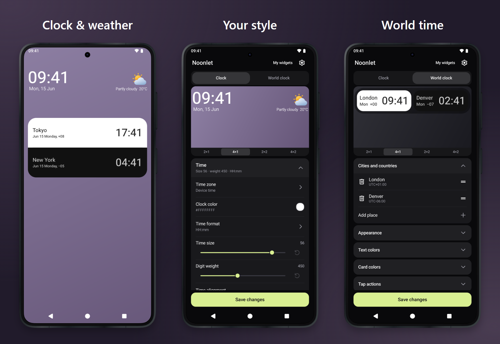
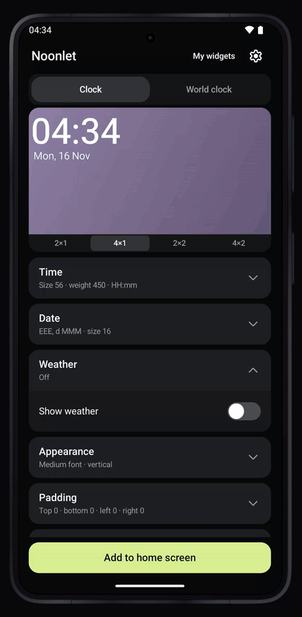

# Noonlet

Home-screen clock widgets for Android 8.0 and later.

[Download APK](https://github.com/YanGranat/noonlet-time-widget/releases/download/v1.4.41/Noonlet-1.4.41.apk)

- **Clock:** time, date, the next system alarm and optional weather, with configurable typography, colors, spacing and tap actions.
- **World clock:** up to four cities or single-timezone countries, with day/night colors and an adjustable rounded backdrop.



[More screenshots](docs/screenshots/)

Each widget has its own settings. Clocks tick inside the launcher using Android `TextClock`, without exact alarms. Optional weather uses Open-Meteo's non-commercial API and either the device location or a manually selected place. Clock and world-clock features work offline.

## Use

Install the APK, open your home screen's **Widgets** menu, and choose **Noonlet**. Settings apply automatically after placement. **Save changes** also saves and refreshes the selected widget, then returns to the home screen. Adding a widget from the app returns home after the launcher confirms placement. By default, clock taps open the system alarm screen and world-clock taps open widget settings.

<p align="center">
  <a href="docs/demo.mp4">
    
  </a>
</p>

The editor offers 2 × 1, 4 × 1, 2 × 2 and 4 × 2 layouts. The selected layout sets the initial size requested when adding from the app. The home screen controls final placement and resizing.

Export or import app and widget settings from **Settings**. Import updates matching widgets; other configurations appear in **My widgets** for placement.

Weekday and month names in widgets follow the phone's language. Weather, day/night colors and time-difference labels refresh periodically and may be delayed by battery-saving modes. Device location is checked when you open Noonlet or refresh weather; while closed, weather uses the last detected place with location permission. A manual location works without location permission.

## Build

Requirements: JDK 21, Android SDK Platform 36, Build Tools 35.0.0, and `ANDROID_HOME` or a local `local.properties` containing the SDK path.

```sh
./gradlew :app:assembleRelease
./gradlew :app:testDebugUnitTest :app:lintRelease
```

On Windows, use `.\gradlew.bat`. Release APKs are written to `app/build/outputs/apk/release/`.

For signing, place your keystore and `signing.properties` in the ignored `.signing/` directory:

```properties
storeFile=release.jks
storePassword=your-store-password
keyAlias=your-key-alias
keyPassword=your-key-password
```

`storeFile` is relative to `.signing/`. Without `signing.properties`, the release APK is unsigned. Keep signing keys private and retain the same key for future updates.

### Verify a rebuild

Use fresh checkouts of the release tag with separate `GRADLE_USER_HOME` directories and no signing settings. Use the tool versions specified above and the checked-in Gradle wrapper. Line endings are defined in `.gitattributes`.

To rebuild `v1.4.41`, keep `kotlin-and-annotations.txt` and `material-symbols.txt` in `app/src/main/assets/licenses/` as CRLF; use LF for the other files in that directory.

```sh
./gradlew :app:assembleRelease --no-build-cache --rerun-tasks
```

With `apksigcopier` and Android's `apksigner` on `PATH`, compare the downloaded release with the unsigned rebuild from the same commit:

```sh
apksigcopier compare --unsigned Noonlet-VERSION.apk app/build/outputs/apk/release/app-release-unsigned.apk
```

On Windows, add `--verify-cmd "apksigner.bat verify"`.

This verifies the rebuild using the release's public signature. The private signing key is not required.

## Development

The app uses Kotlin and Android platform APIs. JUnit and Robolectric test widget layouts, settings, lifecycle, locales and launcher interactions.

To regenerate widget-picker artwork, install `fonttools==4.60.1` in an external Python environment and run:

```sh
python tools/generate_widget_picker_previews.py
```

Add `--check` to verify the checked-in artwork.

## License and privacy

[MIT](LICENSE).

See the [privacy policy](PRIVACY.md) for local storage, location and weather requests.
